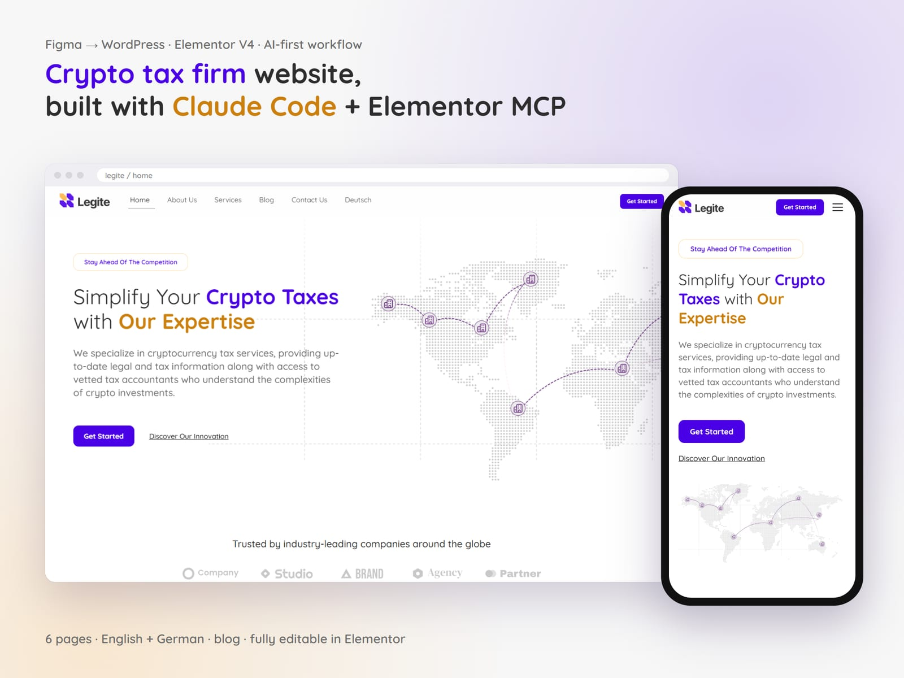
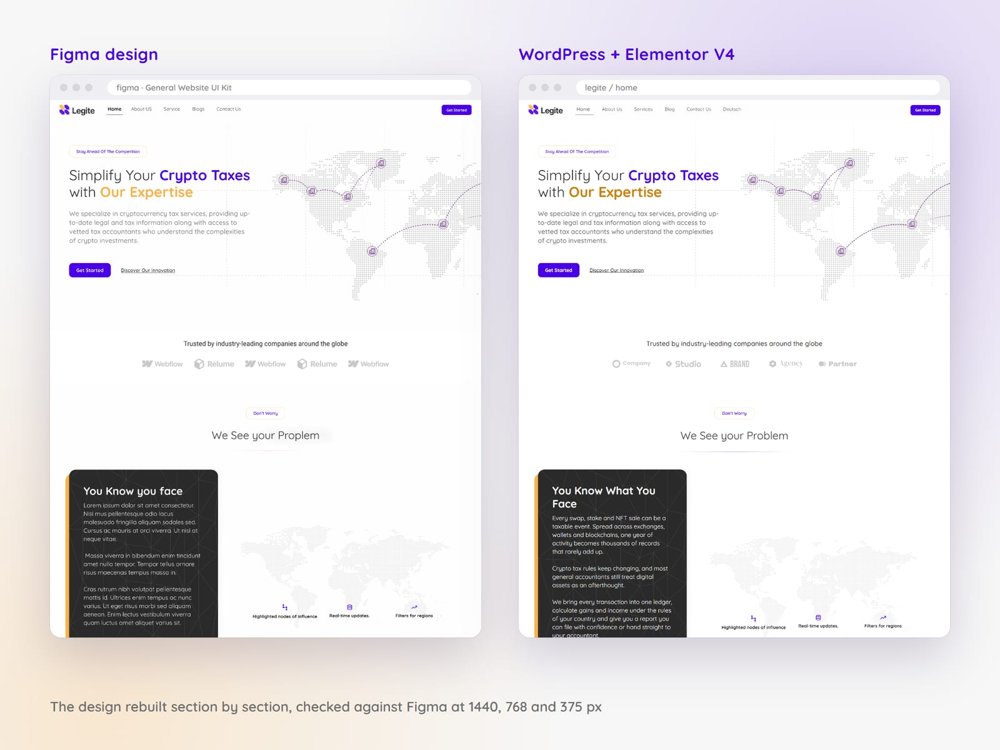

# Figma to Elementor, built AI-first

A WordPress site rebuilt from a Figma UI kit on **Elementor V4 (Free)** and a Hello child theme, with an AI-first workflow: **Claude Code** reads the design through **Figma MCP**, builds real Elementor elements through **Elementor MCP**, and checks every section against the design with **Playwright** before a human reviews it.

The site is a demo for a fictional crypto-tax firm, "Legite". It is a practice and portfolio project, not a client site.



## What was built

- **Pages:** Home, About Us, Services, Contact and a blog (article list, categories, search, article page), in **English and German** (Polylang).
- **Responsive layouts** for tablet and phone, designed during the build: the kit is desktop-only.
- **Elementor V4 atomic elements** everywhere, with a design system of **55 global classes**, **22 variables** and default styles. No HTML widgets, so the whole site stays editable in Elementor.
- **No Elementor Pro.** The header, footer and blog templates are "Site Parts" built in Elementor and rendered by the child theme.
- **8 custom Elementor widgets:** Nav Menu, Menu List, Company Info, Post Grid, Archive Title, Post Header, Post Content, Blog Sidebar.
- **Integrations:**
  - Contact Form 7, styled to the design;
  - company details managed in one admin page (Secure Custom Fields);
  - Yoast SEO for both languages.
- **Interactions** with reduced-motion support: a testimonial carousel, stacked cards, a scroll-driven timeline, a video player, a burger menu.



## How it was built

1. **Assessment.** The agent read the Figma frames once through Figma MCP and saved what it needed: tokens, section inventory, Elementor mapping, risks ([design/assessment.md](design/assessment.md)).
2. **Foundation.** Global variables, classes and default styles in Elementor ([design/tokens.md](design/tokens.md)), plus the header and footer approach.
3. **Section by section.** The agent proposed the desktop, tablet and phone layouts, built the section through Elementor MCP, then checked it with Playwright before the user reviewed it:
   - screenshots at the design width, 768 and 375 px, and the in-between widths where layouts usually break;
   - comparison with the Figma render;
   - keyboard and editor checks.
4. **Everything is recorded:**
   - 45 decisions with their reasons ([docs/decisions.md](docs/decisions.md));
   - a build note for every section ([design/sections.md](design/sections.md));
   - a log of what the agent did, what needed fixing and how long it took ([docs/workflow-log.md](docs/workflow-log.md)).

Where Elementor MCP has gaps, small WP-CLI commands in the theme's tooling fill them, working through Elementor's document API:
- classic widgets inside atomic layouts;
- media import;
- layout export to Git.

**In numbers** (estimates from the log):
- about 35 hours from an empty folder to the finished site, including environment setup and documentation;
- a repeated page built from existing recipes took about 25 minutes;
- the user made no manual edits to the layout — they made the decisions and did the reviews.


## Repository

| Folder | Contents |
|--------|----------|
| `theme/` | the Hello Elementor child theme: PHP, widgets, templates, translations (built assets go to `theme/assets/`, not in Git) |
| `src/` | SCSS, JavaScript and images, built into `theme/assets/` by Gulp (Sass, esbuild, WebP) |
| `elementor/` | the Elementor layout and design system exported for Git ([elementor/README.md](elementor/README.md)) |
| `docker/` | Docker Compose setup scripts and the project's WP-CLI commands |
| `tools/` | asset generators (Figma exports → SVG/WebP), content and SEO texts, portfolio scripts |
| `design/` | design notes: assessment, tokens, responsive rules, section tracker, German translation |
| `docs/` | why the project exists, the plan, decisions, the AI-workflow log |
| `CLAUDE.md` | the project instructions the agent works with |

## Running it locally

Requirements: Docker Desktop, Node 22.

```bash
npm install
npm run wp:start     # WordPress on http://localhost:8888 (MariaDB, WP-CLI, Mailpit)
npm run wp:setup     # install WordPress, Hello Elementor, Elementor and the plugins, activate the theme
npm run build        # build theme/assets/ (npm run dev: watch + browser-sync)
```

The setup creates a local admin, `admin` / `password`. It is for the local Docker site only: never reuse it on a public server.

The pages, Elementor layout and media live in the database. They are not part of the repository. The layout and design system are exported to `elementor/` and can be imported as templates. See [elementor/README.md](elementor/README.md).

## Credits

- Design: [General Website UI Kit](https://www.figma.com/community/file/1575073428722864118/general-website-ui-kit-fully-responsive-ready-to-use) by **Sego** (Figma Community, CC BY 4.0).
- Development: **Alexander S.**, with Claude Code.
- Stock video and article pictures: [Coverr](https://coverr.co/license) (free license).

The code is shared for review. No license is granted for reuse.
